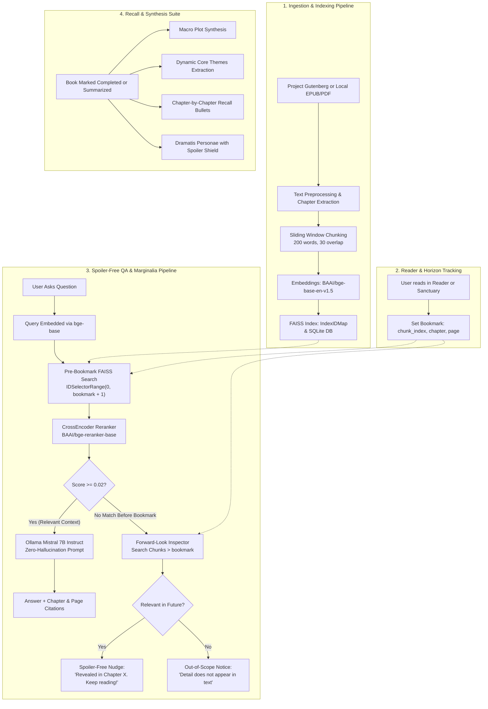

# 📖 Bookie — AI-Powered Literary Reading Companion

> **Read classic & long-form literature with an AI marginalia companion that mathematically guarantees zero spoilers.**

---

## 🌟 Application Purpose

When tackling classic, dense, or multi-volume literature (*Pride and Prejudice*, *Frankenstein*, *Moby Dick*, *The Count of Monte Cristo*), readers constantly encounter forgotten characters, intricate subplots, or unfamiliar references:
- *"Who was Mr. Wickham introduced with in Meryton?"*
- *"Why does Frankenstein feel guilt in Geneva?"*
- *"What happened during the trial scene in Chapter 8?"*

**The Problem:** Looking up questions on search engines, forums, or general AI chatbots is fraught with **catastrophic plot spoilers**. A simple character search often reveals untimely deaths, betrayal twists, or surprise marriages that happen hundreds of pages later.

**The Solution:** **Bookie** gives readers an intelligent reading companion with an enforced **Reading Horizon**:
1. **Spoiler-Free Marginalia**: You read at your own pace and place a bookmark. When you ask a question in the reader drawer, the system retrieves and reasons *only* over the exact text you have read up to that moment.
2. **Forward-Look Hinting**: If you ask about a mystery or character that hasn't unfolded yet, Bookie detects it ahead and nudges you forward (*"This is revealed further along in Chapter X. Keep reading to discover it!"*) without leaking plot details.
3. **Multi-Layer Recall & Summaries**: Refresh your memory with holistic plot summaries, key thematic arcs, chapter-by-chapter recall milestones, and a *Dramatis Personae* character directory equipped with an interactive **Spoiler Shield** toggle.
4. **Physical Sanctuary & 3D Bookshelf**: Track your reading habits, pages turned, and shelf volumes in a distraction-free 3D literary sanctuary.

---

## 🚀 Quick Start: Running on Another Machine

Follow these step-by-step instructions to get Bookie running on a new machine (Windows, macOS, or Linux).

### System Prerequisites
- **Python 3.11+** installed ([python.org](https://www.python.org/downloads/))
- **Node.js 18+** & npm installed ([nodejs.org](https://nodejs.org/))
- **Ollama** installed ([ollama.com](https://ollama.com/))
- **Git** (optional, to clone or copy the repository)

---

### Step 1: Start Ollama & Download the LLM
Bookie uses a local, private Large Language Model for reasoning. Ensure Ollama is running, then pull the default model:

```bash
# In your terminal, pull the Mistral 7B Instruct model:
ollama pull mistral:7b-instruct
```

> 💡 *Note: Keep the Ollama service running in the background. By default, it serves at `http://localhost:11434`.*

---

### Step 2: Backend Setup (FastAPI & AI Pipeline)

1. Open a terminal and navigate to the `backend` directory:
   ```bash
   cd backend
   ```

2. Create a Python virtual environment:
   ```bash
   # Windows, macOS, or Linux:
   python -m venv venv
   ```

3. Activate the virtual environment:
   - **Windows (PowerShell):**
     ```powershell
     .\venv\Scripts\Activate.ps1
     ```
   - **Windows (Command Prompt):**
     ```cmd
     venv\Scripts\activate.bat
     ```
   - **macOS / Linux:**
     ```bash
     source venv/bin/activate
     ```

4. Install the Python dependencies:
   ```bash
   pip install -r requirements.txt
   ```

5. Configure your environment file:
   - **Windows:**
     ```cmd
     copy .env.example .env
     ```
   - **macOS / Linux:**
     ```bash
     cp .env.example .env
     ```

6. Start the FastAPI backend server:
   ```bash
   python run.py
   ```

   > ⚠️ **Important:** Always start the backend from inside the `backend/` directory so the `./data` directory resolves correctly for SQLite and FAISS indexes.
   > The API will be live at `http://localhost:8000` (API documentation at `http://localhost:8000/docs`).

---

### Step 3: Frontend Setup (React & Vite)

1. Open a **new terminal window** and navigate to the `frontend` directory:
   ```bash
   cd frontend
   ```

2. Install npm dependencies:
   ```bash
   npm install
   ```

3. Start the Vite development server:
   ```bash
   npm run dev
   ```

4. Open your browser and visit:
   ```text
   http://localhost:5173
   ```

---

## 🔄 End-to-End Workflow Explained

Bookie operates strictly on local AI models (CPU-friendly, private, and offline-capable). Here is how data moves through the application:



### Detailed Breakdown

### 1. Ingestion & Indexing Pipeline
- **Sources**: Ingest books directly from Project Gutenberg (via Gutendex search) or drag-and-drop local `.epub` and `.pdf` files.
- **Normalization**: Strips Project Gutenberg legal boilerplate, transcriber prefaces, and trailing metadata. Extracts clean chapter titles and page markers.
- **Chunking**: Chunks text into sliding windows of **~200 words with 30-word overlap**. Chunking strictly respects chapter boundaries so that context never bleeds across chapters. Each chunk receives a sequential `chunk_index` representing true reading chronology.
- **Vector Storage**: Embeds each chunk with `BAAI/bge-base-en-v1.5` (768-dimensional normalized vectors). Embeddings are indexed in FAISS (`IndexIDMap(IndexFlatIP)`) where the FAISS ID directly mirrors the SQLite `chunk_index`.

### 2. Reading Horizon & Bookmark System
- As you read in the **Zen Reader** or external reader, you update your bookmark.
- The bookmark records your current `chunk_index`, chapter title, and page number.
- This creates an immutable **reading horizon** representing everything you have consumed so far.

### 3. Spoiler-Free QA & Marginalia Pipeline
When you ask a question in the Reader:
1. **Query Embedding**: The query is converted into an embedding using `BAAI/bge-base-en-v1.5`.
2. **Hardware-Level Spoiler Shield**: FAISS searches the index using:
   ```python
   faiss.SearchParameters(sel=faiss.IDSelectorRange(0, bookmark_chunk_index + 1))
   ```
   Chunks that occur past your current bookmark are strictly invisible to the vector engine.
3. **Cross-Encoder Reranking**: The top 10 retrieved pre-bookmark chunks are reranked using `BAAI/bge-reranker-base`.
4. **Confidence Verification**: Only chunks with a rerank score $\ge 0.02$ are retained.
5. **Answer Generation**: The top 4 coherent chunks are formatted with chapter and page headers and sent to `mistral:7b-instruct` via Ollama with strict anti-hallucination instructions.
6. **Graceful Fallbacks & Forward-Look Hints**:
   - **Case 1 (Pre-bookmark Match)**: Ollama answers strictly from text and cites exact chapters/pages.
   - **Case 2 (Future Occurrence)**: If pre-bookmark has no match, the system checks chunks *after* the bookmark (`chunk_index > bookmark`). If a high-confidence match is found ahead, it returns:
     > *"This is revealed further along in Chapter X. Keep reading to discover it!"*
   - **Case 3 (Not in Book)**: If no match exists anywhere, it confirms the detail does not appear in the narrative.
   - **Case 4 (Ollama Offline)**: If Ollama is temporarily offline or unreachable, Bookie falls back to an offline grounded excerpt reader with exact citations.

### 4. Memory Recall & Summary Engine
When a book transitions to **Completed** (or when browsing recall points):
- **Macro Plot Arc**: Synthesizes the overall narrative journey and dramatic milestones.
- **Dynamic Themes**: Identifies recurring literary motifs, philosophical questions, and societal themes dynamically extracted from the text.
- **Chapter-by-Chapter Recall Points**: Provides bullet-point summaries of key events and conversations chapter by chapter to refresh memory.
- **Dramatis Personae**: Complete directory of characters with descriptions and an interactive **Spoiler Shield** toggle:
  - *Bounded Mode*: Reveals only characters and events introduced up to your current bookmark.
  - *Unlocked Full Volume*: Reveals the complete cast for finished readers.

---

## 🛠️ Architecture & Tech Stack

| Component | Technology | Role / Specification |
|---|---|---|
| **Backend Framework** | FastAPI (Python 3.11+) | Async REST API, CORS middleware, Pydantic validation |
| **Database & ORM** | SQLite + SQLAlchemy 2.0 | Books, Chapters, Chunks, Reading Lists, Summaries, Bookmarks |
| **Vector Engine** | FAISS (`faiss-cpu`) | Fast inner-product similarity search with ID range masking |
| **Embedding Model** | `BAAI/bge-base-en-v1.5` | 768-dimensional normalized text embeddings |
| **Cross-Encoder Reranker** | `BAAI/bge-reranker-base` | Semantic precision scoring with confidence threshold $\ge 0.02$ |
| **Local LLM** | `mistral:7b-instruct` (Ollama) | Low-temperature (0.1) grounded synthesis & prompt shielding |
| **Document Parsers** | PyMuPDF, EbookLib | Clean chapter and synthetic/real page extraction |
| **Frontend Framework** | React 19 + Vite | Fast single-page application with responsive layouts |
| **3D Rendering** | Three.js | Cloth-bound tilting book spines & realistic shelf lighting |
| **Styling** | Tailwind CSS v4 | Literary aesthetic with warm paper palettes and serif typography |
| **Icons & UI** | Lucide React | Clean, minimalist reading icons |

---

## 📂 Project Structure

```text
Reading Companion/
├── backend/
│   ├── app/
│   │   ├── parsers/            # PDF and EPUB parsing utilities
│   │   ├── routers/            # FastAPI route handlers
│   │   │   ├── books.py        # Search Gutenberg & upload books
│   │   │   ├── library.py      # Reading list management & stats
│   │   │   ├── bookmarks.py    # Bookmark positions & progress
│   │   │   ├── qa.py           # Spoiler-free Q&A endpoint
│   │   │   └── summary.py      # Macro summaries, themes, recall points
│   │   ├── services/           # Core AI & business logic
│   │   │   ├── chunking.py     # Chapter-bounded sliding window chunker
│   │   │   ├── embedding.py    # SentenceTransformers & BGE Reranker
│   │   │   ├── vector_store.py # FAISS IndexIDMap management
│   │   │   ├── retrieval.py    # Range-constrained retrieval & forward hints
│   │   │   ├── generation.py   # Ollama prompt orchestration & offline fallback
│   │   │   ├── gutendex.py     # Project Gutenberg API client
│   │   │   └── summary.py      # Dynamic theme & recall point generation
│   │   ├── config.py           # Pydantic configuration (.env loader)
│   │   ├── db.py               # SQLAlchemy database session & engine
│   │   ├── main.py             # FastAPI entrypoint & schema auto-sync
│   │   ├── models.py           # Database entities (Book, Chunk, Summary, etc.)
│   │   └── schemas.py          # Pydantic request & response schemas
│   ├── data/                   # SQLite database & FAISS index files (.index)
│   ├── .env.example            # Backend environment variables template
│   ├── requirements.txt        # Python package dependencies
│   └── run.py                  # Direct entrypoint (python run.py)
├── frontend/
│   ├── src/
│   │   ├── api/
│   │   │   └── client.js       # Axios/fetch API client connected to backend
│   │   ├── pages/
│   │   │   ├── LandingHeroView.jsx    # Hero welcome page
│   │   │   ├── SanctuaryDeckView.jsx  # 3D interactive bookshelf & library
│   │   │   ├── DashboardView.jsx      # Reading habits, pages read, statistics
│   │   │   ├── Reader.jsx             # Zen Reader & spoiler-free marginalia drawer
│   │   │   ├── SummaryView.jsx        # 4-layer recall points & spoiler shield
│   │   │   ├── BookmarkView.jsx       # Dedicated bookmark progress manager
│   │   │   └── IngestView.jsx         # Gutenberg catalog search & file uploader
│   │   ├── App.jsx             # Top-level routing and reading focus state
│   │   └── main.jsx            # React root mount point
│   ├── package.json            # Node.js dependencies & scripts
│   ├── vite.config.js          # Vite config with API proxy to port 8000
│   └── tailwind.config.js      # Custom theme & typography styling
└── README.md                   # You are here
```

---

## ⚙️ Configuration & Environment Variables

The backend configuration is managed via `backend/.env`. You can customize the settings below:

| Variable | Default Value | Description |
|---|---|---|
| `EMBEDDING_MODEL` | `BAAI/bge-base-en-v1.5` | SentenceTransformers model for chunk & query embeddings |
| `RERANKER_MODEL` | `BAAI/bge-reranker-base` | CrossEncoder model for context reranking |
| `OLLAMA_URL` | `http://localhost:11434` | URL of the running Ollama instance |
| `GENERATION_MODEL` | `mistral:7b-instruct` | LLM used for answering questions and synthesizing summaries |
| `RETRIEVE_K` | `10` | Number of candidate chunks retrieved from FAISS |
| `RERANK_TOP_N` | `4` | Number of top reranked chunks provided to the LLM |
| `RERANK_THRESHOLD` | `0.02` | Minimum semantic relevance score required to answer |
| `MAX_NEW_TOKENS` | `400` | Maximum token limit for LLM generation |
| `CHUNK_WORDS` | `200` | Target word count per chunk window |
| `CHUNK_OVERLAP_WORDS` | `30` | Overlap word count between adjacent chunks |
| `WORDS_PER_PAGE` | `300` | Words per synthetic page for EPUB/text files |
| `DATA_DIR` | `./data` | Directory where SQLite DB and FAISS index files reside |

---

## ❓ Frequently Asked Questions & Troubleshooting

### 1. What if Ollama is offline or not installed?
Bookie has a **graceful offline fallback**. If Ollama is unreachable, the system automatically surfaces verbatim, text-grounded excerpts with citations matching your bookmark, ensuring you are never blocked.

### 2. Can I use a remote Ollama server?
Yes. If your GPU machine is running Ollama on another IP on your local network (e.g. `http://192.168.1.50:11434`), simply update `OLLAMA_URL` in `backend/.env`.

### 3. Does Bookie require an active internet connection?
Only when searching and downloading new books from Project Gutenberg. Once ingested, all text parsing, FAISS vector search, embeddings, reranking, and LLM inferences run **100% locally on your machine**.

### 4. Can I use another Ollama model?
Yes. You can pull other instruction-tuned models such as `llama3.2:3b-instruct` or `gemma2:9b` via `ollama pull <model_name>` and update `GENERATION_MODEL=<model_name>` in `backend/.env`.

---

## 📜 License & Acknowledgments
- Built with [FastAPI](https://fastapi.tiangolo.com/), [FAISS](https://github.com/facebookresearch/faiss), [SentenceTransformers](https://sbert.net/), [Ollama](https://ollama.com/), and [React](https://react.dev/).
- Classical texts provided freely via [Project Gutenberg](https://www.gutenberg.org/) and the [Gutendex API](https://gutendex.com/).
